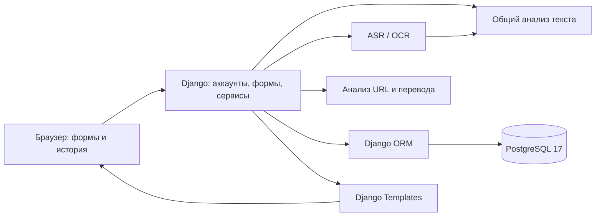

# Архитектура «Альфа Защиты»

**Статус: согласованный план от 25 октября 2026 года, гостевой режим уточнён 26 октября.** Проект разрабатываем с нуля; этот документ не подтверждает готовность кода. Стек: Python 3.11, Django 5.2 LTS, Django Templates и PostgreSQL 17. Обоснования — в [STACK.md](STACK.md).

## 1. Источники и границы продукта

Актуальный состав продукта задают [kharchenko_application.md](kharchenko_application.md) и [SPECIFICATION.md](SPECIFICATION.md). По прямому решению пользователя они уточняют исходную заявку: разработка начинается с нуля, добавлены аудио, скриншоты и обратная связь. [application_2359.md](application_2359.md) сохраняется как неизменная исходная копия, `idea.md` — как прежний замысел; утверждения о переносе старого проекта не описывают текущую реализацию.

Согласованы девять функциональных требований:

| ID | Функция | Основная часть приложения |
| --- | --- | --- |
| F01 | Пользовательский аккаунт | `accounts` и Django auth/sessions |
| F02 | Проверка текста | `checks` → `analysis.text` |
| F03 | Проверка URL | `checks` → `analysis.url` |
| F04 | Проверка аудиосообщения | ASR → общий анализ текста |
| F05 | Проверка скриншота переписки | OCR → общий анализ текста |
| F06 | Оценка обстоятельств предстоящего перевода | `analysis.transfer`, доступная личная история |
| F07 | Импорт истории транзакций из CSV | `transactions` |
| F08 | Сохранение и просмотр личной истории проверок | `checks` |
| F09 | Добавление и исправление отзыва о проверке | `checks.CheckFeedback`, отдельный `checks.TrainingConsent` |

Пять способов проверки — текст, URL, аудио, скриншот и перевод — **не означают пять самостоятельных ML-моделей**. Аудио и скриншоты подают извлечённый текст в общий анализатор. Объяснения, рекомендации и ограничения входят в результат каждой проверки.

**Все пять разовых проверок доступны гостю и вошедшему пользователю.** Гостевой результат существует только на текущем экране, без постоянного хранения. Для гостевого перевода личная история не используется. Импорт CSV, сохранённая история и отзывы доступны только после входа и только владельцу данных. Состав F01–F09 остаётся прежним.

Первая версия рассчитана на русскоязычные ситуации и переводы в рублях. Сервис помогает оценить ситуацию до перевода; банк не подключает, деньги не переводит и платежи не блокирует. Экспорт результатов, учебные карточки и другие дополнения в обязательный объём не добавляем.

Из `ProjectGuide` следуют требования к GUI, серверной БД и доступу к своим данным с разных устройств (презентация, слайды 2 и 4), минимуму девяти функций с аккаунтом как одной функцией (слайды 9–10), обоснованию инструментов (слайды 12–13), объектному проектированию, проверке и демонстрации (Word, §1, §4–5, §9–10). Самостоятельная работа должна включать содержательный анализ, а не только интерфейс к чужому сервису (Word, §0; слайд 3).

Источники: [Word-гайд](ProjectGuide/Гайд%20по%20IT-проектам.docx), [презентация](ProjectGuide/08.10%20ИТ%20%28ПР%29.pptx). Согласованный список функций не является гарантией оценки комиссии.

## 2. Одно приложение с понятными модулями

Используем **модульный монолит**: аккаунты, проверки, импорт и анализ разделены в коде и вызывают друг друга как Python-функции. Django принимает формы, запускает обработку, при необходимости сохраняет данные через ORM и возвращает HTML из DTL-шаблонов. Это сокращает объём инфраструктуры для одного разработчика со сроком до 5 ноября.



Монолит описывает организацию кода. Экземпляр приложения — его запущенная копия; сервер БД — отдельная программа. PostgreSQL может размещаться отдельно от Django. Дополнительные экземпляры приложения или серверы сейчас не требуются для самого разделения на модули.

Начало проверки общее: `urls.py` → `views.py` → проверка формы → сервис → анализ. Для вошедшего пользователя результат сохраняется, затем выполняется перенаправление на его страницу. Гостю результат возвращается сразу в ответе на отправленную форму; отдельного адреса сохранённой проверки нет. Анализаторы принимают обычные Python-данные и возвращают результат; HTML, сессии и ORM остаются в веб-части. Анализ будет общим для гостя и аккаунта; сейчас он ещё не реализован.

## 3. План структуры

Ниже будущая структура, а не перечень уже созданных файлов. Пустые папки заранее не создаём.

```text
alphago1v/
├── kharchenko_application.md # актуальная заявка
├── kharchenko_userscripts.md # семь пользовательских сценариев
├── kharchenko_diagrams.md    # объекты и классы по сценариям
├── SPECIFICATION.md         # функции, входы и критерии приёмки
├── application_2359.md      # неизменная исходная копия
├── ARCHITECTURE.md          # устройство приложения
├── STACK.md                 # технологии и альтернативы
├── IMPLEMENTATION_PLAN.md   # порядок работ
├── ML_PLAN.md               # данные, разметка и оценка анализа
├── ProjectGuide/            # требования к проекту
├── README.md                # установка, запуск и демонстрация
├── pyproject.toml           # зависимости и настройки инструментов
├── uv.lock                  # фиксированные версии Python-пакетов
├── compose.yaml             # только локальная PostgreSQL
├── .github/workflows/ci.yml # обязательные проверки GitHub Actions
├── .env.example             # пример настроек без секретов
├── manage.py
├── config/                  # настройки, URL, стандартные WSGI/ASGI-точки входа
├── accounts/                # пользователь, регистрация, вход
├── checks/                  # проверки, результаты, личная история, отзывы
├── transactions/            # импорт CSV и история операций
├── analysis/                # типы данных; текст, URL, перевод; адаптеры ASR/OCR/ML
├── templates/               # Django Templates
├── static/                  # CSS и небольшой JavaScript
├── ml/                      # отдельные подготовка данных, обучение и оценка
├── tests/                   # pytest + pytest-django
├── examples/                # шаблон CSV и вымышленные примеры
├── docs/                    # исследование, тестирование, размещение, защита
└── var/                     # локальные артефакты и временные файлы; вне Git
```

`accounts`, `checks`, `transactions` — Django-приложения внутри одного проекта. В них по необходимости используются `models.py`, `forms.py`, `views.py`, `urls.py`, `services.py` и собственная папка `migrations`. Универсальный слой репозиториев поверх ORM не нужен. Составные операции находятся в сервисах, простые запросы — в ORM.

`wsgi.py` и `asgi.py` — стандартные точки входа, а не два обязательных процесса. Сервер запуска выберем вместе с провайдером. Объектные и классовые диаграммы по сценариям оформляем отдельно; схема компонентов их не заменяет. Сдаваемые документы размещаем и именуем по `ProjectGuide`.

## 4. Аккаунты и данные

Используем Django auth, хеширование паролей, серверные сессии в PostgreSQL и CSRF-защиту. `accounts.User` на базе `AbstractUser` задаём до первых миграций. Регистрация, проверка владельца данных и ограничение попыток входа требуют нашей настройки и проверки. Для HTTPS настраиваем защищённые cookie; пользовательский текст выводим с экранированием.

HTTP аккаунтов подключен в `accounts/views.py` и `accounts/urls.py`; простые шаблоны находятся в `templates/accounts`. `LoginAttempt` хранит по одному счетчику на IP. `login_view` блокирует его строку в транзакции, допускает пять ошибок за 15 минут от первой ошибки, затем возвращает 429 до проверки пароля. Существующий `login_user` остается внутренней операцией без HTTP-лимита. Исходящий HTML формируется после завершения транзакции. Для общего счетчика между процессами используется уже выбранная PostgreSQL, без отдельного кеша.

Таблица ниже описывает постоянные данные. Гостевая проверка в БД не записывается; схема не меняется, `Check.user` остаётся обязательным (`NOT NULL`).

| Модель или данные | Что хранится |
| --- | --- |
| `accounts.User` | Учётная запись на основе `AbstractUser`. |
| `accounts.LoginAttempt` | Уникальный IP из `REMOTE_ADDR`, число ошибок и начало окна входа. Пароли и логины в счетчике не хранятся. |
| Сессии Django | Состояние входа и срок действия стандартным механизмом Django. |
| `checks.Check` | Владелец, вид и вход проверки, извлечённый текст для аудио/скриншота, снимок результата и использованного контекста, отдельный `error_message`, дата и версия анализатора. Объяснения, ограничения и версии моделей при их использовании входят в результат. |
| `transactions.TransactionImport` | Владелец загрузки, дата, число строк, период и контрольная сумма файла. |
| `transactions.Transaction` | Ссылка `history` на загрузку, `occurred_at`, целое `amount_kopecks`, валюта RUB, `direction` (`incoming` / `outgoing`) и необязательный условный ID контрагента `recipient`. |
| `checks.CheckFeedback` | Один исправляемый отзыв владельца на проверку: `fraud` / `ordinary` / `unknown`, необязательный комментарий и время изменения. Связь `check_record` один к одному. |
| `checks.TrainingConsent` | Отдельная связь `check_record` один к одному, текущее `granted` (по умолчанию `False`), время изменения и версия условий. Отсутствие записи также означает запрет. |

**История проверок и история транзакций — разные данные.** Первая сохраняет ответы сервиса, вторая служит контекстом новых проверок перевода. Суммы храним целым числом копеек; при чтении используем точное десятичное представление, а не `float`.

`TransactionImport.user` — связь один к одному: хранится только активная загрузка. Ее удаление через `CASCADE` удаляет операции. История прежних CSV не накапливается; сохраненные снимки проверок остаются независимыми.

Каждое чтение и изменение сохранённых личных данных требует входа и ограничено пользователем из сессии. Переданный браузером ID не даёт права открыть чужую проверку, импорт или отзыв. Связи и допустимые значения закрепляем ограничениями БД.

Контракт `create_check` для гостя — несохранённый объект `Check`: `user_id=None`, `pk=None`, `created_at` содержит текущее время. Только для этого объекта `full_clean` исключает проверку обязательного поля `user`; остальные поля проверяются как обычно. `save()` вызывается только для проверки вошедшего пользователя. Гостевой режим определяем по `user_id`: обращение к обязательной связи `check.user` без владельца может вызвать исключение. `finish_check` для гостя также изменяет только объект в памяти, без `save()`.

Гостевые входы, извлечённый текст и результат не сохраняем в БД, cookie или сессии. Временная обработка исходного медиа сохраняется. Отдельные сервисы, анонимные владельцы, токены доступа и постоянное хранилище для гостевых проверок не нужны.

**Сохранённый результат неизменяем.** Новая версия модели, замена CSV и исправление отзыва его не переписывают. Снимок содержит использованные агрегаты истории и ограничения, не зависит от дальнейшего существования старого импорта. Повторное открытие результата не запускает анализ заново.

`finish_check` принимает готовый результат или сообщение об ошибке. Для аккаунта выполняется один условный `UPDATE` по ID, владельцу и `status='pending'`; повторный вызов не может переписать итог. Для гостя меняются только поля объекта в памяти. Неизменяемость обеспечивается операцией завершения и отсутствием пользовательского пути редактирования результата; запрета любых обновлений через ORM или SQL нет.

Отзыв — непроверенное сообщение пользователя, а не установленный факт мошенничества и не исправление исходного прогноза. Автоматического обучения или дообучения по отзывам нет. Данные проверки могут попасть в будущую обучающую выборку только после отдельного добровольного согласия; аккаунт, загрузка CSV и отзыв сами по себе таким согласием не являются. Даже согласованные данные требуют проверки качества и разметки до обучения.

Серверные операции отзывов и согласий подготовлены: `save_check_feedback` и `get_check_feedback`, `save_training_consent` и `has_training_consent`. Запись разрешена только для своей проверки с готовым результатом (`completed`). Формы проверяют ввод, `update_or_create` создает или изменяет одну текущую запись. Исходный `Check` не сохраняется заново. Согласие можно изменить независимо от отзыва; оно действует только для текущей версии [условий](docs/TRAINING_CONSENT.md). Старую версию нельзя отправить как согласие на новые условия.

## 5. Обработка проверок и файлов

Общий результат разделяет оценку риска, достаточность данных и технический статус. Пропущенное поле означает «неизвестно». Нехватку истории, ошибку распознавания и недоступную модель нельзя превращать в ответ «безопасно». Процент вероятности не показываем без обоснования и проверки такой шкалы.

**Текст и URL.** Текст поступает в общий анализатор. URL анализируется как строка: сервер не открывает проверяемый адрес, не следует перенаправлениям и не загружает содержимое сайта. Это ограничивает вывод: содержимое страницы и её текущее поведение не проверены.

**Аудио и скриншот.** Файл проходит проверку типа, размера и ограничений обработки. ASR распознаёт речь, OCR извлекает текст с сохранением порядка реплик; затем вызывается тот же текстовый анализ. Извлечённый текст и ограничения распознавания доступны в результате: для аккаунта сохраняются в истории, для гостя остаются только на текущем экране. Исходное аудио или изображение хранится временно и удаляется после обработки, включая ошибки; для остаточных файлов после сбоя предусматриваем очистку. Исходные медиа не входят в постоянную историю или будущую обучающую выборку.

**Перевод.** Сервис получает согласованные поля из спецификации и, после входа, доступную прошлую историю владельца. Гостевой перевод проверяется только по введённым данным, без персональной истории. Отсутствие истории или идентификатора получателя явно ограничивает соответствующие сравнения. Необычная сумма или новый получатель сами по себе не доказывают мошенничество. История содержит только операции, предшествующие проверяемому переводу.

**CSV.** Импорт доступен только после входа. Поддерживаем один документированный шаблон, а не все банковские выписки. Проверяем весь файл, заголовки, поля, даты, суммы, число строк и размер до изменения БД. При ошибке показываем строку и причину, прежняя история остаётся. Успешный импорт **атомарно заменяет историю целиком**; интерфейс предупреждает об этом заранее. Похожие строки не удаляем молча.

Реализованные операции находятся в `transactions`: `read_transactions_csv` разбирает файл, `import_transactions` заменяет историю, `get_user_transactions` возвращает готовый список своих операций, `delete_user_transactions` удаляет свою загрузку. Формат и лимиты: [docs/CSV_FORMAT.md](docs/CSV_FORMAT.md). HTTP-страницы еще не подключены.

Разбор файла и анализ выполняются вне длительной транзакции БД. Замена истории — короткая атомарная операция; импорт и удаление одного пользователя блокируют его строку через `select_for_update` внутри `transaction.atomic`. Это работает и при первой загрузке. Операции читаются одним запросом; для анализа потребуется явно передать момент отсечения через `before`. Блокировка БД во время вычислений не удерживается. Старые результаты проверок сохраняются после замены CSV.

## 6. ML, время ответа и ограничения

Обучение и оценку выполняем отдельно от веб-запросов. Приложение использует подготовленный артефакт с известной версией; импорт CSV и отзыв не запускают обучение. Конкретные алгоритмы, библиотеки, наборы данных и модели ASR/OCR/анализа выбираем после сравнения качества, времени ответа и потребления ресурсов на русскоязычных примерах.

Проверка должна укладываться в лимиты выбранного хостинга. Сначала измеряем длительность, память и таймауты на допустимых входах, затем уточняем лимиты файлов и способ выполнения. **Очередь задач, отдельные workers и брокер сейчас не утверждены**; добавлять их можно только при подтверждённой необходимости. При сбое не выдаём результат так, будто анализатор успешно отработал.

## 7. Окружение, размещение и проверка

Локально Python работает в `/Users/Shared/github/MachineLearning/ml_venv`, а **PostgreSQL 17 — в Docker** с постоянным хранилищем. Общий venv сохраняем. Зависимости проекта описываем в `pyproject.toml` и фиксируем `uv.lock`; чистую установку проверяем отдельно. Docker для Django-приложения не является обязательным.

Для сайта выбран управляемый хостинг Django и PostgreSQL. Провайдер, сервер запуска и точные patch-версии будут определены при развёртывании. Установка использует фиксированные зависимости, миграции, сборку статики, HTTPS и секреты из окружения. Сервер разработки для публичного сайта не используем. Данные переживают перезапуск приложения; резервную копию проверяем восстановлением. Учётная запись приложения не является администратором БД.

**GitHub Actions обязателен:** установка по lock-файлу, проверка его актуальности, PostgreSQL 17 service, системные проверки Django, проверка отсутствующих миграций, применение миграций и запуск `pytest` с `pytest-django`. Проверки БД идут на PostgreSQL. Перед сдачей отдельно проверяем обновление существующей БД, сохранность данных и восстановление копии.

Основные проверки охватывают F01–F09: все пять режимов для гостя и аккаунта, отсутствие сохранения гостевых данных, доступ к личным данным только владельцу после входа, ошибки входа/распознавания, очистку медиа, CSV без частичной замены, влияние истории на перевод, неизменность результатов, исправление отзыва и отсутствие согласия по умолчанию. Отдельно проверяем, что гость не получает CSV, сохранённые проверки и отзывы, а финализация гостевого результата не записывает объект в БД. Пользовательские CSV, тексты, медиа, секреты, дампы и обучающие данные не попадают в Git и обычные технические логи. Артефакты моделей поставляются отдельно с версией и инструкцией получения.

Пользовательское исследование проверяет понятность предупреждений и ограничений. Его результаты и фактические результаты тестирования оформляем отдельно; автоматические тесты не заменяют исследование.

## 8. Порядок работ и оставшиеся решения

По последнему решению пользователя порядок такой: бэкенд → фронтенд → ML → итоговая интеграция и проверка. Серверную логику сначала проверяем тестами; анализ риска остаётся незавершённым до ML-этапа. Каждую небольшую порцию кода объясняем и ждём её просмотра перед следующей. Детали и сроки — в [IMPLEMENTATION_PLAN.md](IMPLEMENTATION_PLAN.md).

**4 ноября 2026 года — фиксация финальной версии; 5 ноября — сдача. После дедлайна коммитов нет.**

Остаётся выбрать данные, разметку, методы и категории результата, библиотеки/модели ASR и OCR, провайдера и сервер запуска, точные patch-версии и измеренные лимиты обработки. CSV-шаблон и направление операций определены; минимум истории для статистики выберем при проверке анализа перевода. До завершения аккаунтов решаем восстановление пароля (пока не обещано); до публичного размещения — сроки хранения и удаления данных. Моменты принятия решений указаны в [SPECIFICATION.md](SPECIFICATION.md).

Состав F01–F09, версии основных платформ, uv, тестовые инструменты, CI и управляемое размещение уже согласованы.
