# Диаграммы

Харченко Богдан Никитич, 11и2. Сначала объекты, затем классы; в конце — этапы работы.

**S01. Аккаунт — F01**

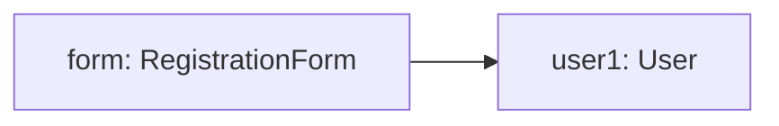

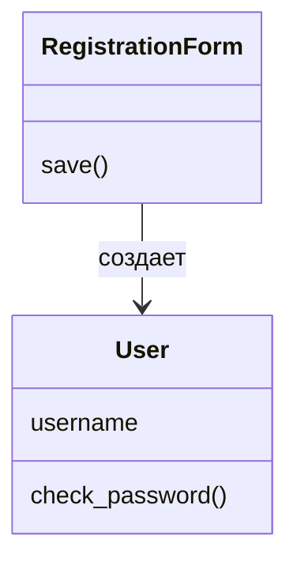

**S02. Текст — F02**

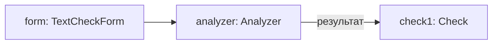

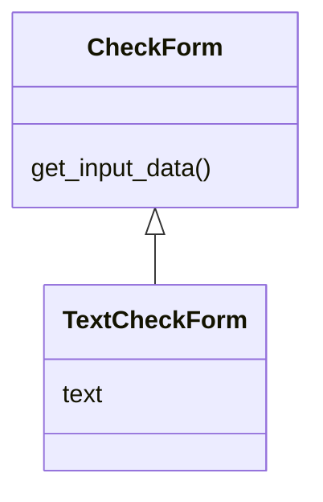

**S03. Ссылка — F03**

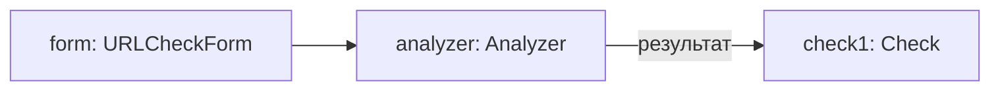

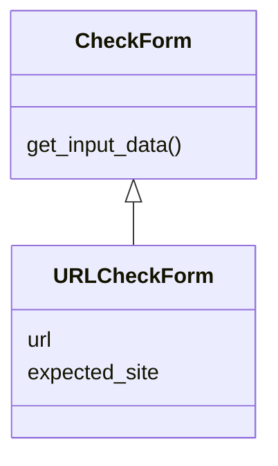

**S04. QR-код — F04**

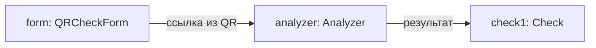

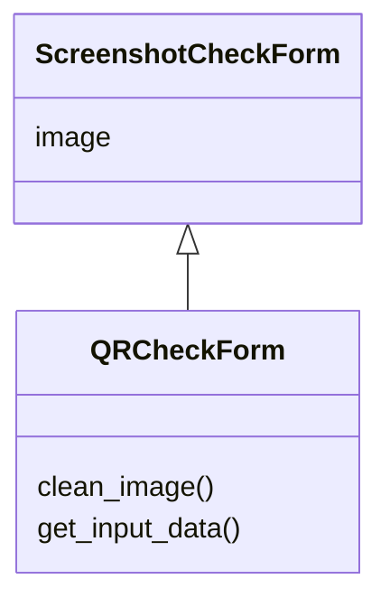

**S05. Скриншот — F05**

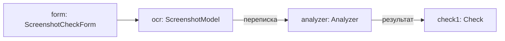

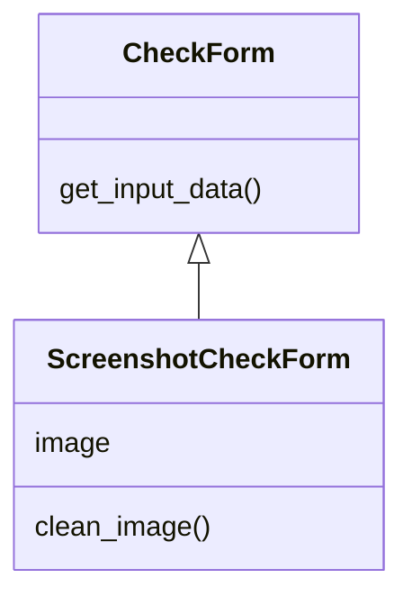

**S06. История операций — F07**

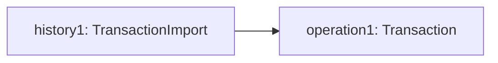

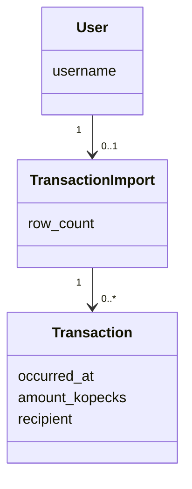

**S07. Перевод — F06**

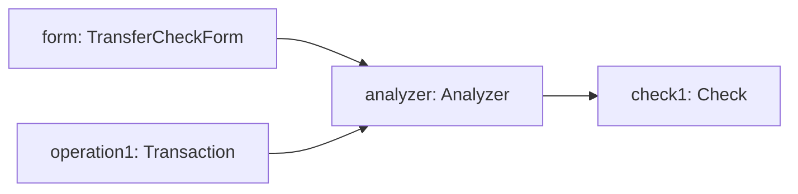

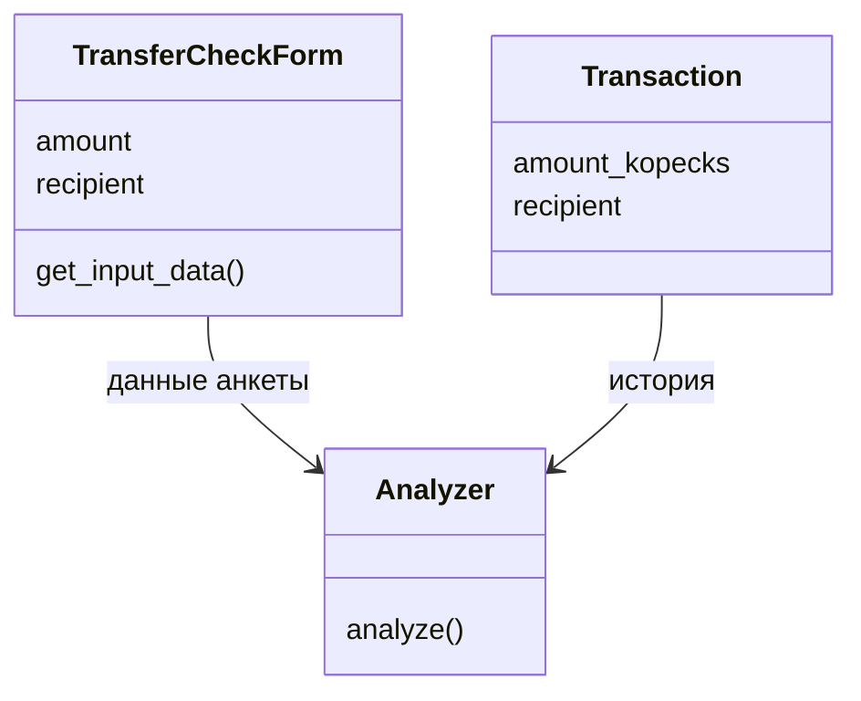

**S08. История проверок — F08**

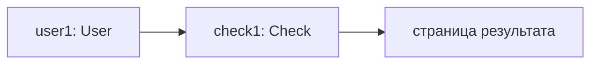

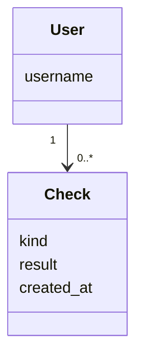

**S09. Отзыв и согласие — F09**

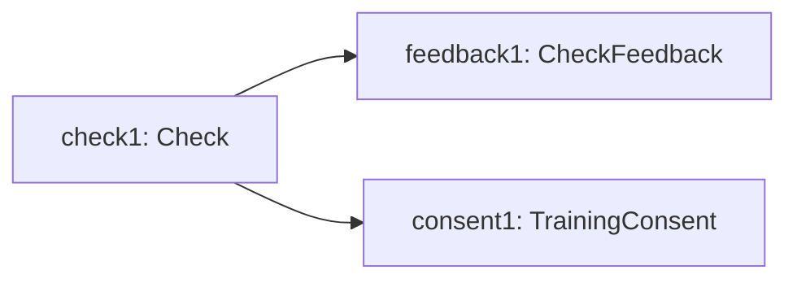

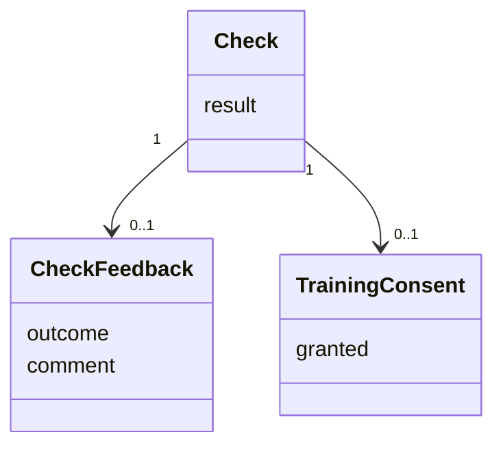

## Этапы работы

Работа в текущем репозитории. Даты разработки взяты из истории Git; отдельный второй показ и отправка материалов в 2359 обозначены как план на 5 ноября.

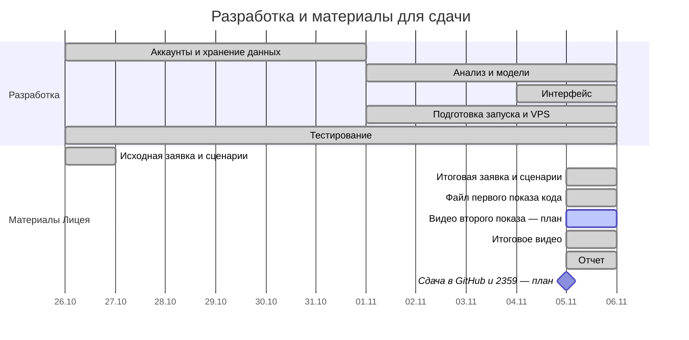
