**Объектные и классовые диаграммы «Альфа Защиты»**

**Статус:** проектирование с гостевым режимом, 26 октября 2026 года. Диаграммы соответствуют [семи сценариям](kharchenko_userscripts.md) и [спецификации](SPECIFICATION.md). Основа Django, логика аккаунтов, хранилище и серверные формы проверок подготовлены; анализ и HTTP-обработчики пока не реализованы. Все экземпляры и значения в объектных схемах условные.

**Как читать схемы**

Для каждого сценария приведены объектная схема и UML-диаграмма классов, как требует Word-гайд (§4–5). UML показывает только нужную сценарию часть сущностей. Сервисы обозначают проектные роли и операции, а не обязанность создавать отдельный класс для каждой функции.

`Check` содержит исходные сведения, снимок результата и версию анализа; для аудио и скриншота также извлечённый текст. Для вошедшего пользователя эти сведения сохраняются в БД, для гостя доступны только на текущем экране и могут потеряться после закрытия или перезагрузки страницы. Исходные медиа обрабатываются временно. `CheckFeedback` хранит редактируемый непроверенный отзыв к сохранённой проверке отдельно от прогноза. История транзакций и история проверок — разные данные; CSV, история и отзывы доступны только после входа.

**Гостевой объект и сохранённая запись**

`create_check(user, kind, input_data)` возвращает гостю несохранённый объект `Check`: `user_id=None`, `pk=None`, `created_at` — текущее время. Общая валидация сохраняется; для гостя `full_clean` исключает только поле `user`. В БД `Check.user` остаётся обязательным (`NOT NULL`). Связь `User → Check` на всех диаграммах относится только к сохранённым записям. `Guest` обозначает посетителя без входа, а не новую таблицу или аккаунт. Создание подготавливает проверку; отдельная `finish_check` однократно фиксирует результат или ошибку, сохраняя в БД только итог владельца. Сам анализ пока не подключён.

**S01. Аккаунт и история с другого устройства — F01, F08**

**Объектная схема**

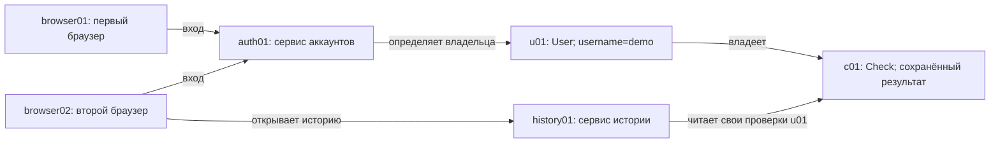

**UML классов**

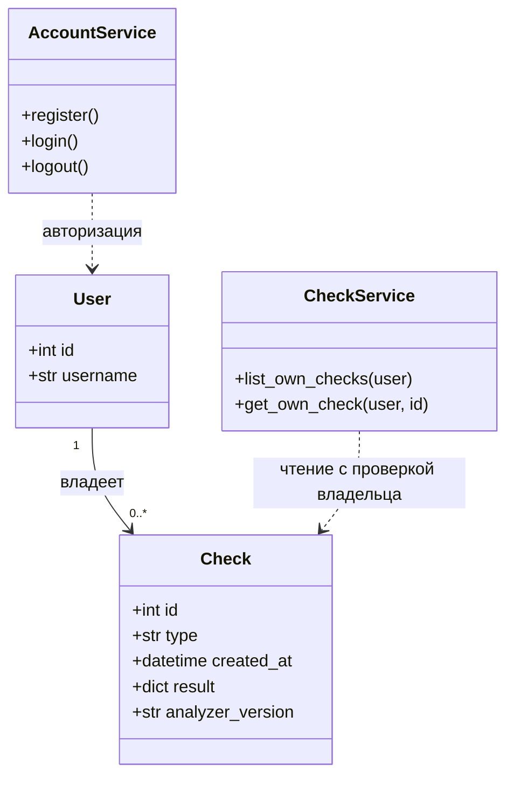

**S02. Текстовое сообщение — F02**

**Объектная схема**

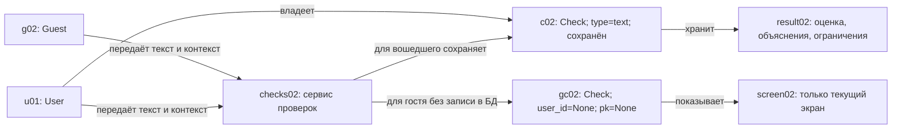

**UML классов**

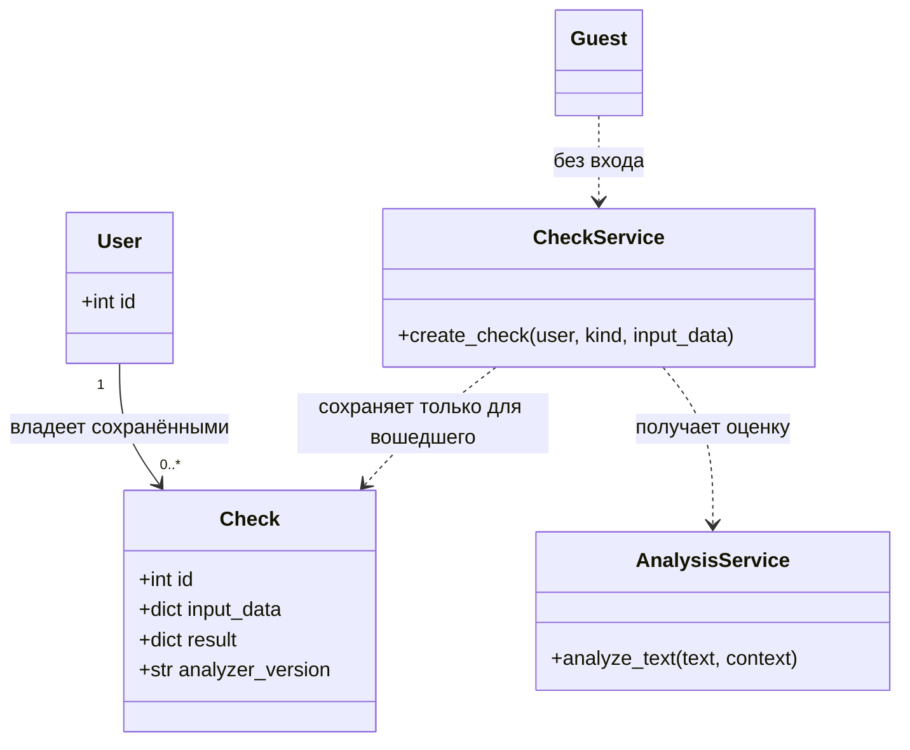

**S03. Ссылка — F03**

**Объектная схема**

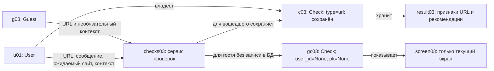

**UML классов**

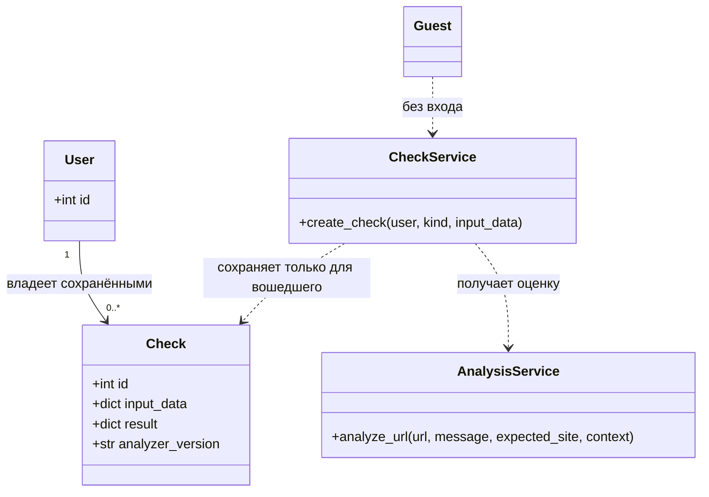

**S04. Аудиозапись — F04**

**Объектная схема**

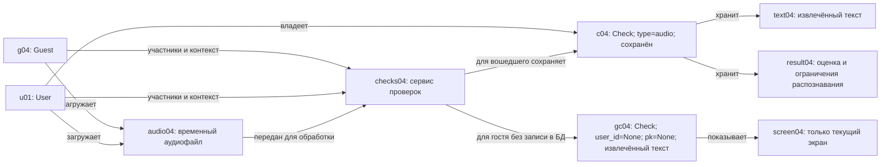

**UML классов**

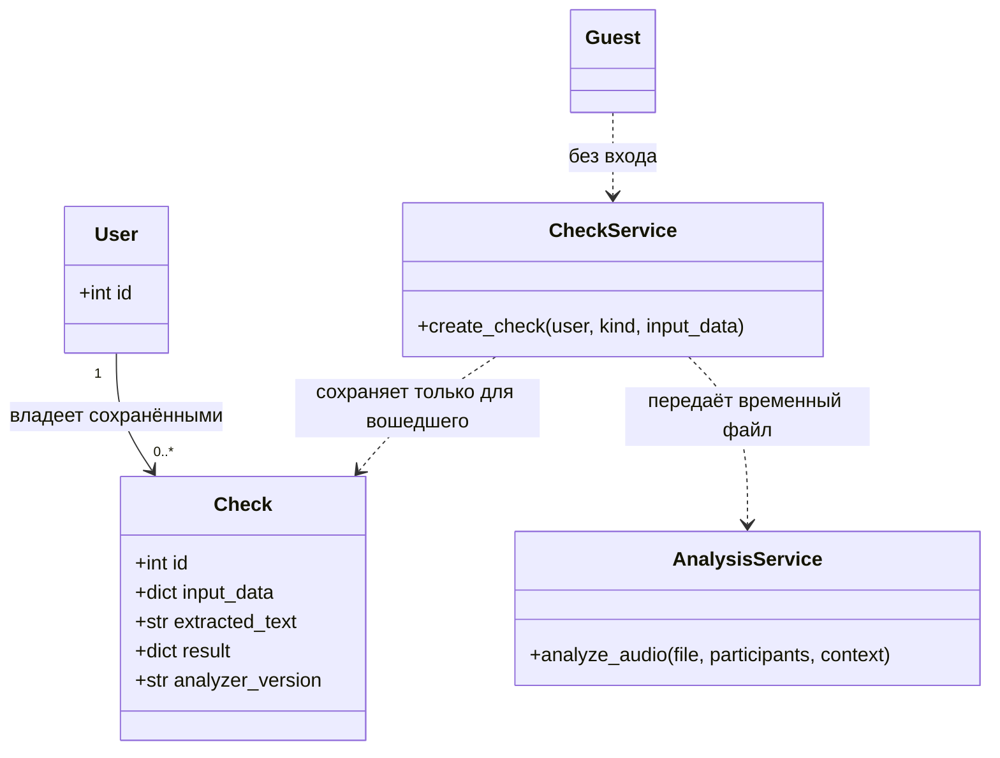

**S05. Скриншот переписки — F05**

**Объектная схема**

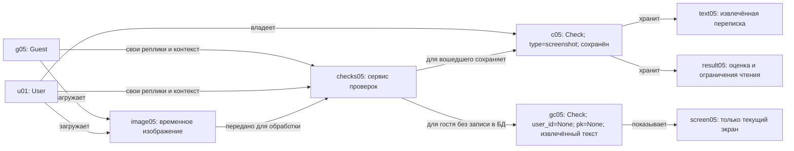

**UML классов**

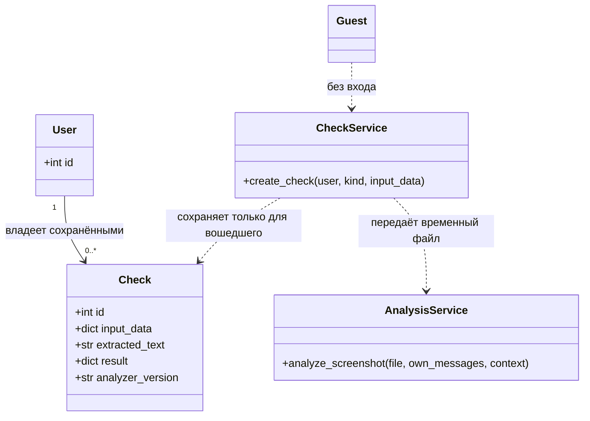

**S06. CSV и предполагаемый перевод — F06, F07**

**Объектная схема**

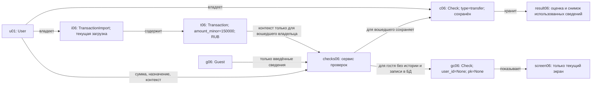

Для гостя экземпляры `i06` и `t06` недоступны; проверка выполняется только по введённым сведениям с указанием ограничений. Вошедший пользователь также может выполнить проверку без истории. Ошибка нового импорта не меняет прежнюю историю.

**UML классов**

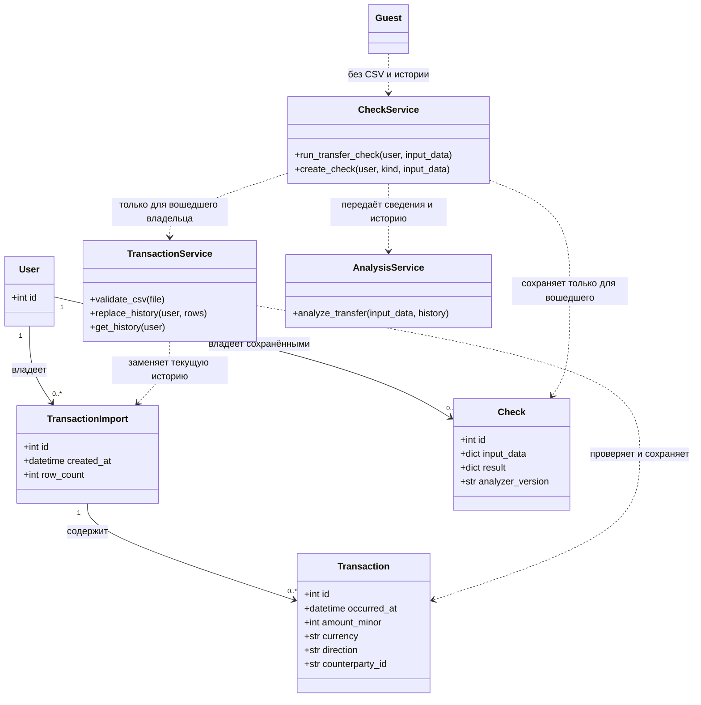

Сумма хранится в целых минимальных денежных единицах, для рублей — копейках. Назначение и обстоятельства предполагаемого перевода относятся к `Check.input_data`, а не добавляются в CSV только ради этой схемы. Сохранённый результат не зависит от последующей замены истории.

**S07. Обратная связь по проверке — F08, F09**

**Объектная схема**

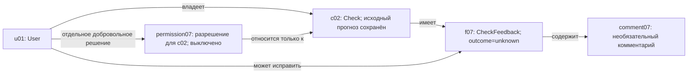

**UML классов**

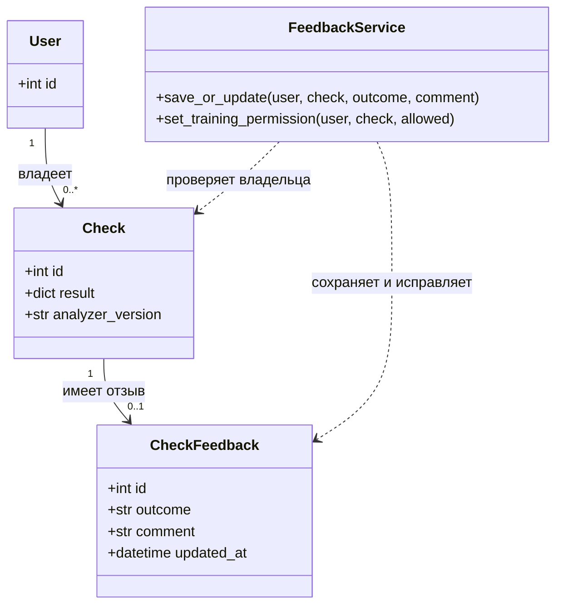

Сценарий доступен только после входа и только для своей сохранённой проверки. У гостевого несохранённого `Check` отзыва нет; доступ к чужой сохранённой проверке закрыт.

`outcome` принимает `fraud`, `ordinary` или `unknown`: мошенничество, обычная ситуация или неизвестно. Отзыв остаётся непроверенным и не меняет исходный прогноз. Разрешение на использование данных конкретной проверки для подготовки будущего обучения по умолчанию выключено и учитывается отдельно от отзыва; способ его хранения определяется спецификацией. Наличие разрешения не означает проверенную разметку или выполненное обучение. Операции обучения в этот сценарий не входят.
