**Диаграммы**

Для каждого сценария сначала объекты, затем классы. Check хранится в БД только после входа; у гостя это объект в памяти.

**S01. Аккаунт и история**

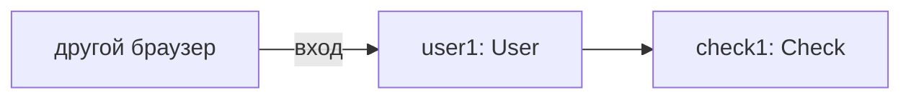

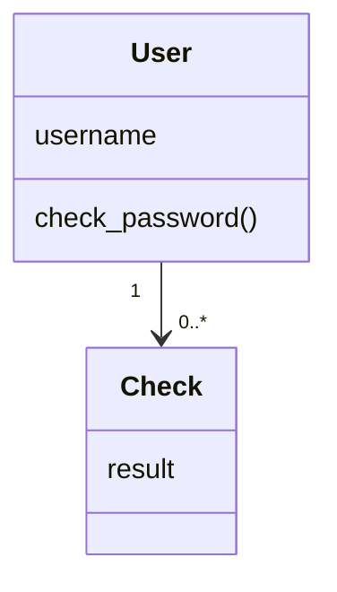

**S02. Текст**

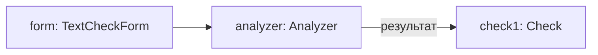

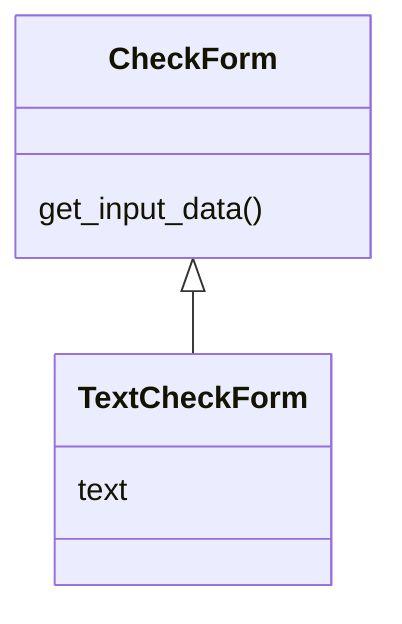

**S03. Ссылка**

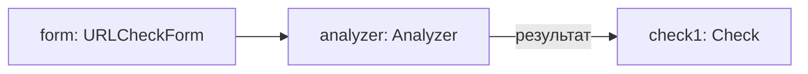

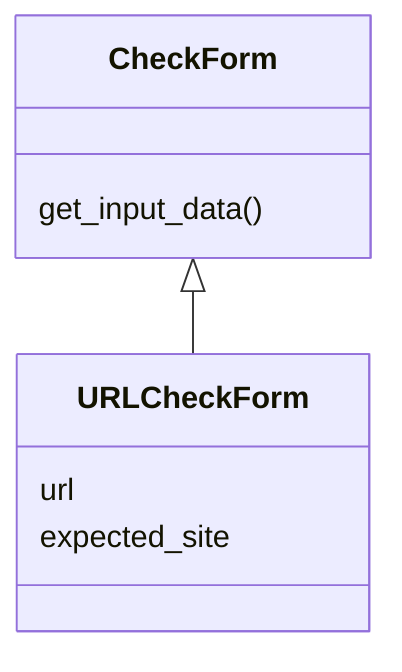

**S04. QR-код**

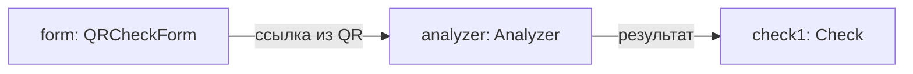

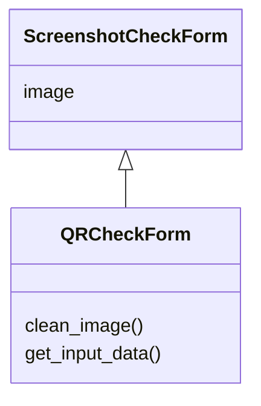

**S05. Скриншот**

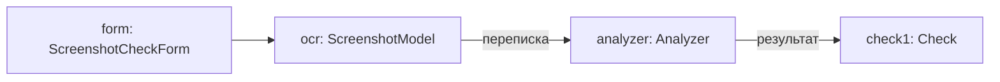

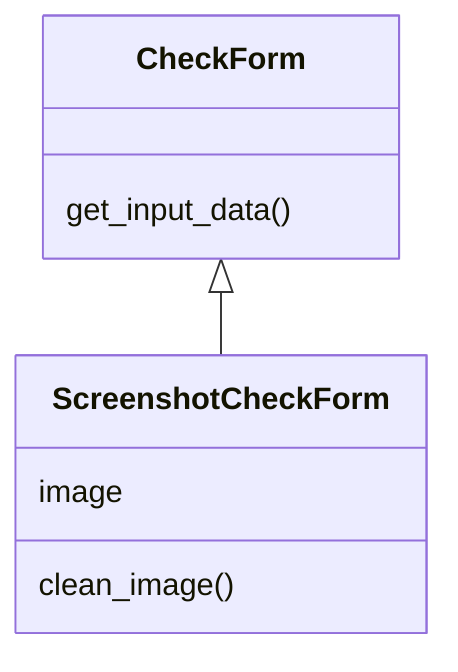

**S06. История операций и перевод**

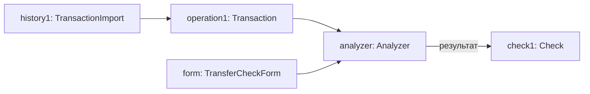

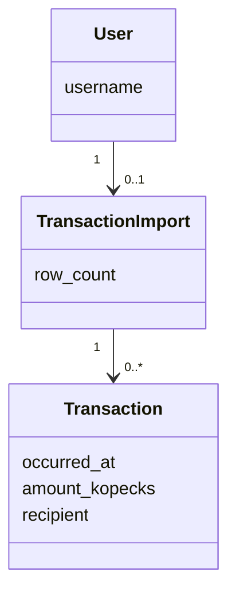

**S07. Отзыв и согласие**

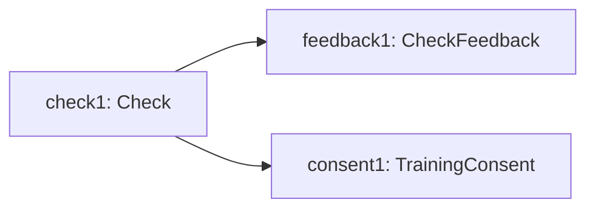

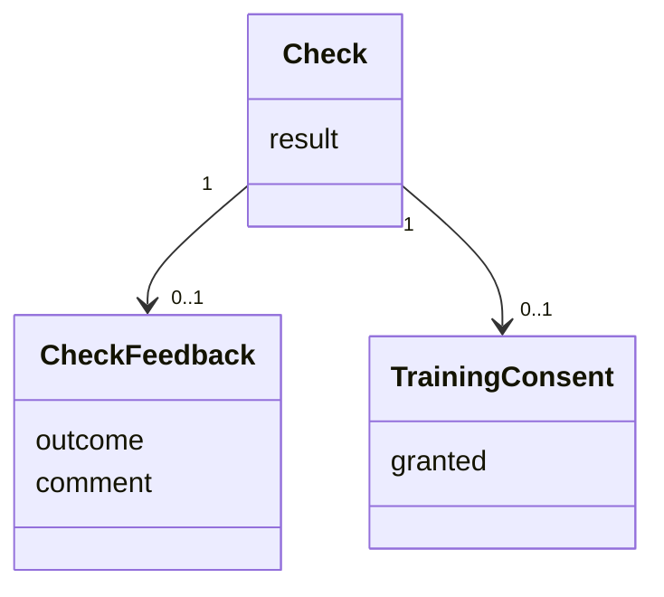
