**Объектные и классовые диаграммы «Альфа Защиты»**

**Статус:** проектирование, 25 октября 2026 года. Диаграммы соответствуют [семи сценариям](kharchenko_userscripts.md) и [спецификации](SPECIFICATION.md). Приложение и изображённые классы пока не реализованы. Все экземпляры и значения в объектных схемах условные.

**Как читать схемы**

Для каждого сценария приведены объектная схема и UML-диаграмма классов, как требует Word-гайд (§4–5). UML показывает только нужную сценарию часть сущностей. Сервисы обозначают проектные роли и операции, а не обязанность создавать отдельный класс для каждой функции.

`Check` хранит исходные сведения, снимок результата и версию анализа; для аудио и скриншота также сохраняется извлечённый текст. Исходные медиа обрабатываются временно. `CheckFeedback` хранит редактируемый непроверенный отзыв отдельно от прогноза. История транзакций и история проверок — разные данные.

**S01. Аккаунт и история с другого устройства — F01, F08**

**Объектная схема**

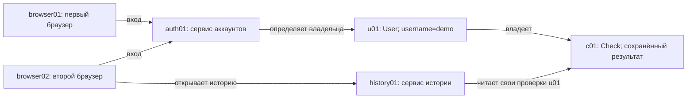

**UML классов**

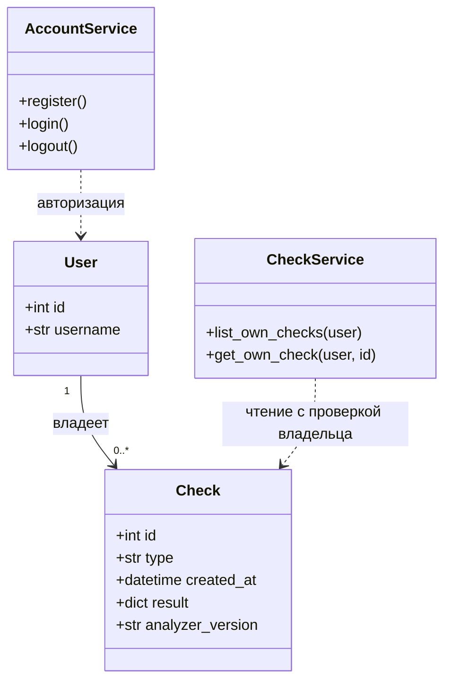

**S02. Текстовое сообщение — F02**

**Объектная схема**

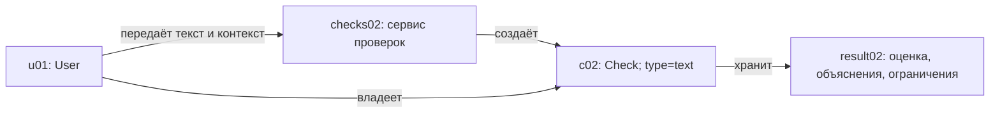

**UML классов**

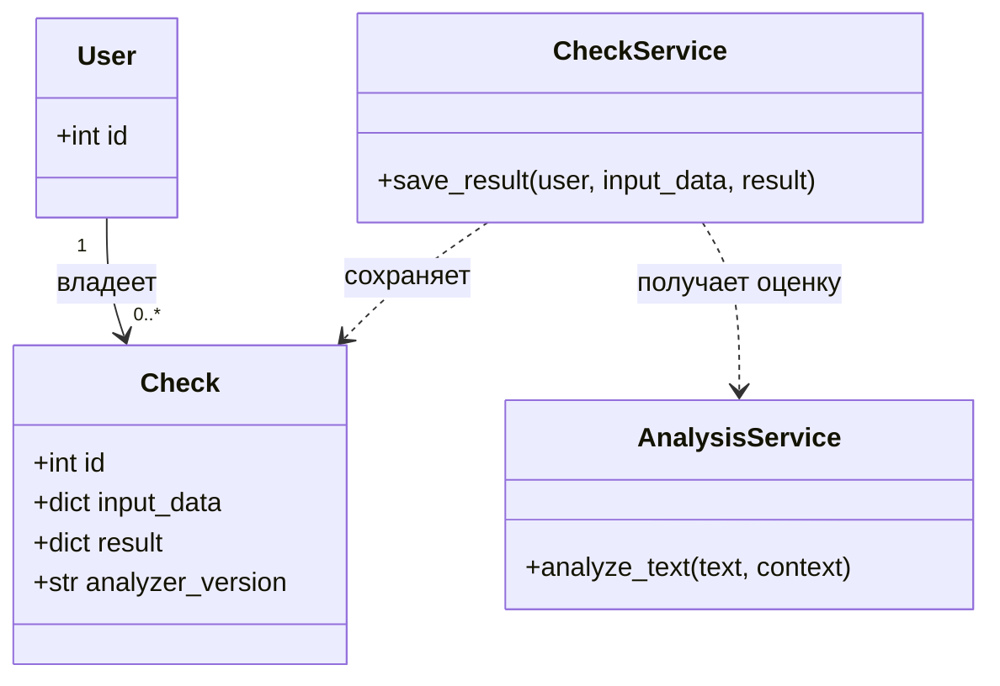

**S03. Ссылка — F03**

**Объектная схема**

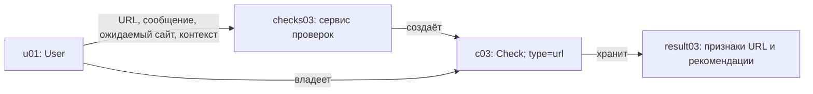

**UML классов**

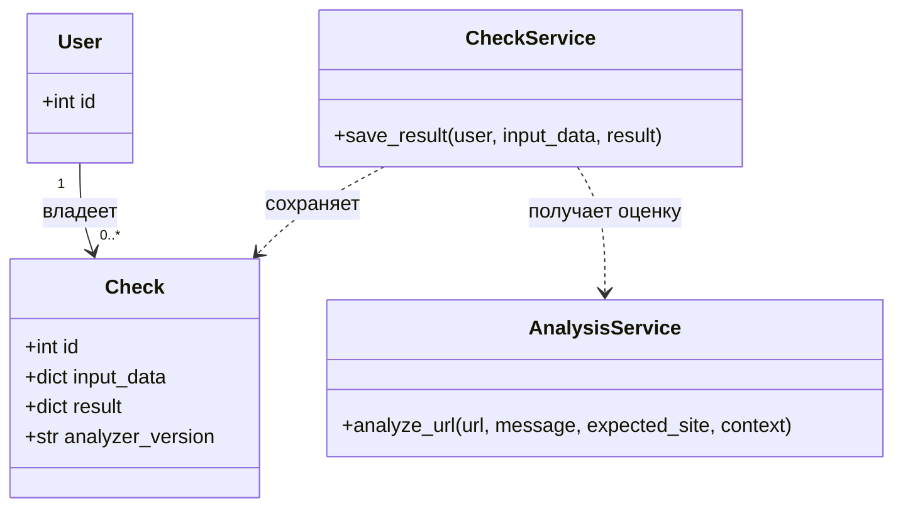

**S04. Аудиозапись — F04**

**Объектная схема**

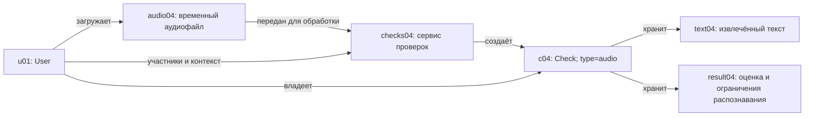

**UML классов**

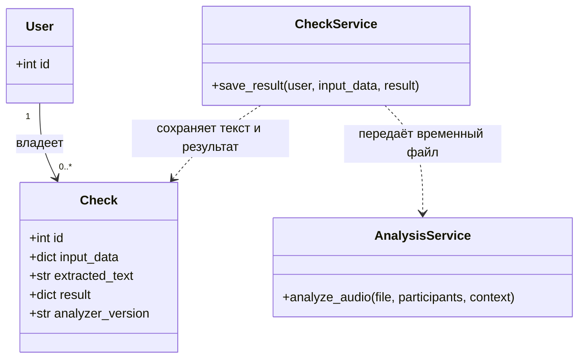

**S05. Скриншот переписки — F05**

**Объектная схема**

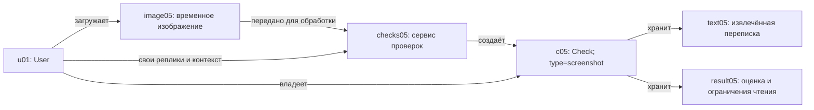

**UML классов**

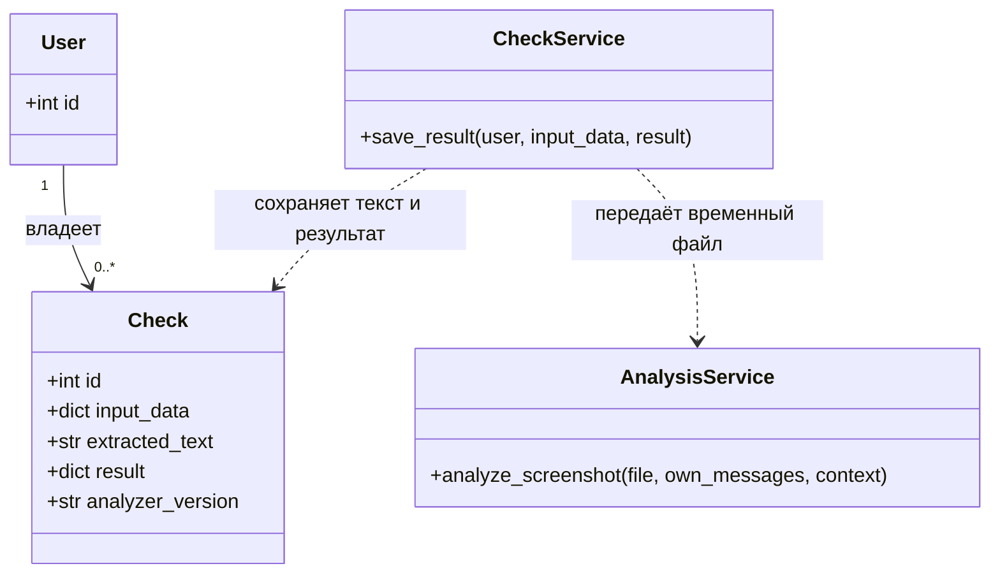

**S06. CSV и предполагаемый перевод — F06, F07**

**Объектная схема**

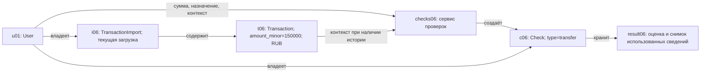

Без загруженной истории экземпляры `i06` и `t06` отсутствуют; проверка выполняется по введённым сведениям с указанием ограничений. Ошибка нового импорта не меняет прежнюю историю.

**UML классов**

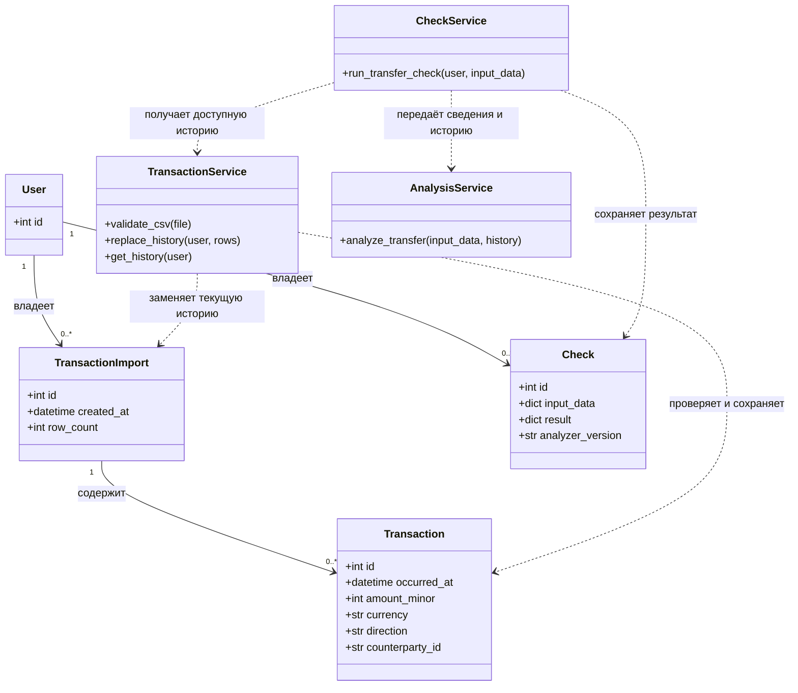

Сумма хранится в целых минимальных денежных единицах, для рублей — копейках. Назначение и обстоятельства предполагаемого перевода относятся к `Check.input_data`, а не добавляются в CSV только ради этой схемы. Сохранённый результат не зависит от последующей замены истории.

**S07. Обратная связь по проверке — F08, F09**

**Объектная схема**

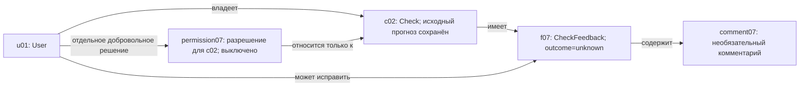

**UML классов**

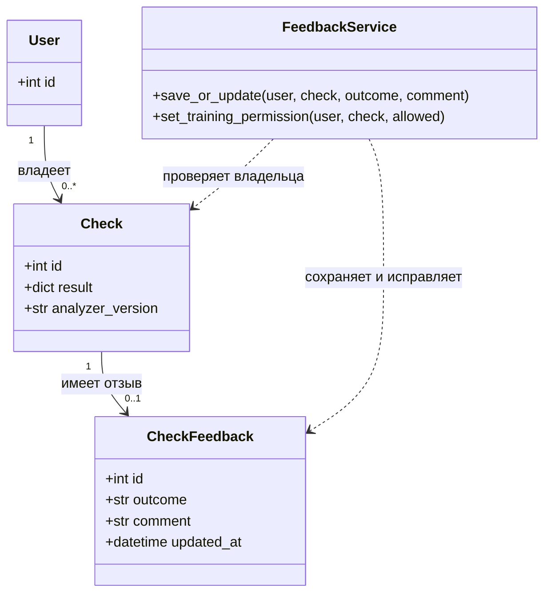

`outcome` принимает `fraud`, `ordinary` или `unknown`: мошенничество, обычная ситуация или неизвестно. Отзыв остаётся непроверенным и не меняет исходный прогноз. Разрешение на использование данных конкретной проверки для подготовки будущего обучения по умолчанию выключено и учитывается отдельно от отзыва; способ его хранения определяется спецификацией. Наличие разрешения не означает проверенную разметку или выполненное обучение. Операции обучения в этот сценарий не входят.
